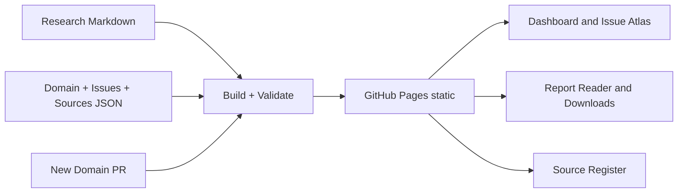

# 系统架构与工程决策

## 原则
1. **Content-first / Git as CMS**：所有领域均由 Markdown + JSON 发布；无后端、无 API Token、无私有用户数据。
2. **Evidence first**：Issue 引用 sourceIds，来源单独保存，支持后续去重和跨域引用演进。
3. **Schema contract**：`schemaVersion:1`，所有领域经过同一 validator 校验。
4. **Build = reproducibility**：在 CI 中生成 Word 下载，发布内容不依赖运行时数据获取。
5. **Path portability**：JS 通过 `import.meta.url` 确定站点根路径；适配 GitHub Pages 的 `/AI-bottleneck/` 子目录。
6. **Low maintenance**：当前阶段不需要 React/Vite/数据库，规模达到数十领域后再评估静态索引构建与搜索性能。

## 数据流

## 页面信息架构
- Overview：研究规模、首个领域、P0 问题、报告入口。
- Issue Atlas：关键词、严重度、类别、成熟度的组合筛选。
- Issue Drawer：根因、症状、方案对比、局限、指标、引文。
- Report Archive/Reader：保留完整原始 Markdown，通过统一阅读器提供目录、代码块、表格。
- Evidence：所有研究来源、类型、链接、描述。
- Methodology：证据边界、等级定义、新领域接入。
- Roadmap：明确尚未发布的行业，不展示假数据。

## 非功能约束
- 无服务端运行时，无账户或用户跟踪。
- 键盘快捷键 `/`、`Ctrl/Cmd + K` 可打开搜索；`Esc` 关闭。
- 明暗主题、`prefers-reduced-motion`、响应式移动端。
- 所有外部链接必须明确目标域，文本渲染进行 HTML escaping。
- 对未完备的文件或数据提供错误提示，不显示伪造数字。

## 未来演进
当领域数量较多：构建时生成统一倒排索引（Fuse.js/MiniSearch），抽象 issue/source 的跨领域关联，支持年份/研究版本筛选、对比视图以及静态导出 API；必要时再引入后端，而非过早复杂化。
